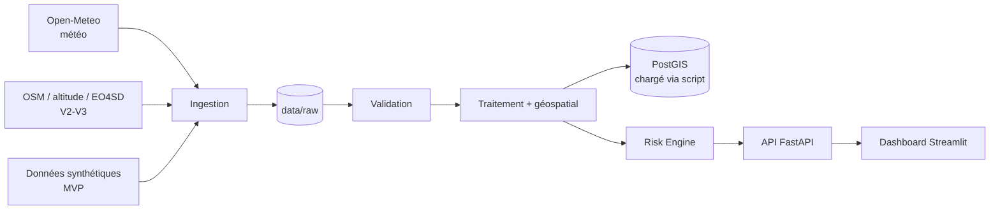

# MBEUD-mi — Analyse géospatiale des inondations à Dakar

**Système prototype d'aide à la décision et de priorisation des interventions face aux inondations urbaines (Dakar).**

> ⚠️ **Prototype expérimental, non validé.** Le dashboard principal utilise des données synthétiques. Un jeu expérimental séparé utilise le MNT de Dakar pour le relief, mais plusieurs autres variables restent synthétiques.
> Ce projet **ne remplace pas** l'ANACIM, les autorités, les services d'urgence ni les systèmes officiels.
> Un résultat de simulation n'est **jamais** une prévision officielle.

## 1. Problème

À Dakar, de fortes pluies provoquent rapidement des inondations (quartiers, routes, accès aux services). Une prévision donne la quantité de pluie, mais pas **où elle aura le plus d'impact**.

## 2. Objectif

Répondre à : *« Si une forte pluie est prévue, quelles zones risquent d'être les plus impactées, et où prioriser les moyens ? »*

## 3. Solution

Un pipeline qui transforme des données (pluie, terrain, population, infrastructures) en un **Flood Risk Score (0-100)** par cellule de 500 m, affiché sur une carte, avec classement, alertes, recommandations et simulation de ressources.

## 4. Architecture



Détails : [docs/architecture.md](docs/architecture.md). **Dans le MVP, l'API lit le fichier GeoJSON** ; PostGIS est fourni (schéma + chargeur) et deviendra la source de l'API en V3 (voir [docs/decisions.md](docs/decisions.md)).

## 5. Sources de données

Voir [docs/data_sources.md](docs/data_sources.md) : sources réelles identifiées (Open-Meteo, Banque mondiale / ESA EO4SD, HDX, ANACIM...) et ce qui est synthétique.

## 6. Méthodologie · 7. Risk Score

[docs/methodology.md](docs/methodology.md) et [docs/risk_model.md](docs/risk_model.md). En bref :
`Risk = f(Hazard, Vulnerability, Exposure)`, chaque variable normalisée entre 0 et 1, poids modifiables dans `config/risk.yaml`.

## 8. Installation

**Option A — Docker (recommandé)**
```bash
cp .env.example .env        # puis change POSTGRES_PASSWORD
docker compose up --build
```
- Dashboard : http://localhost:8501
- API / Swagger : http://localhost:8000/docs
- PostGIS : `localhost:5433`

**Option B — Python local**
```bash
python3 -m venv .venv && source .venv/bin/activate
pip install -r requirements/dev.txt -r requirements/dashboard.txt
PYTHONPATH=. uvicorn api.main:app --port 8000        # terminal 1
API_URL=http://localhost:8000 streamlit run dashboard/app.py   # terminal 2
```

## 9. Utilisation

```bash
PYTHONPATH=. python scripts/generate_synthetic.py       # (re)génère les données de démo
PYTHONPATH=. python scripts/run_pipeline.py --rain 120  # pipeline en ligne de commande
PYTHONPATH=. python scripts/load_to_postgis.py --rain 120   # charge dans PostGIS (db lancée)
```
Dans le dashboard, change la **pluie prévue** dans la barre latérale : carte, classement, alertes et ressources se recalculent.

## 10. API

| Méthode | Route | Rôle |
|---|---|---|
| GET | `/health` | état du service |
| GET | `/zones` | liste des zones |
| GET | `/risk?rain_mm=` | scores de toutes les zones (GeoJSON) |
| GET | `/risk/{zone_id}` | détail d'une zone (3 blocs + recommandations) |
| GET | `/forecast?total_mm=` | évolution T-24h → T+6h (courbe de pluie synthétique) |
| POST | `/simulation` | scénario complet + ressources proposées |
| GET | `/recommendations` | priorités proposées par niveau |
| GET | `/alerts?rain_mm=` | zones les plus à risque |

## 11. Dashboard

7 pages : Overview, Risk Map, Forecast, Zones, Simulation, Resources, Alerts.

## 12. Tests

```bash
pip install -r requirements/dev.txt
python -m pytest -q        # 64 tests : score, niveaux, validation, géospatial, scénarios, ressources, API, intégration
```

## 13. Évaluation exploratoire EO4SD — 2009

Une première comparaison a été réalisée avec la couche historique
d'étendues d'inondation de Dakar pour 2009, issue du catalogue
ESA EO4SD-Urban.

- Zones expérimentales comparées : 862.
- Pluie utilisée pour le scénario : 120 mm, hypothétique.
- Corrélation de Spearman entre le score MNE et le recouvrement
  historique : 0,0759.
- Score moyen pour un recouvrement inférieur à 1 % : 61,716.
- Score moyen pour un recouvrement d'au moins 1 % : 63,599.
- Zones présentant au moins 10 % de recouvrement : 84.

La corrélation observée est très faible. Cette analyse est descriptive :
elle ne démontre pas que le modèle prédit correctement les inondations.
Les variables d'exposition et de drainage restent notamment synthétiques.

Rapport détaillé : [docs/evaluation_eo4sd_2009.md](docs/evaluation_eo4sd_2009.md).

## 14. Limitations (à lire)

- **Dashboard principal** : les simulations utilisent des données synthétiques. Le jeu expérimental utilise le MNT de Dakar pour l'altitude et la pente, mais la population, les infrastructures, le drainage et l'historique restent synthétiques. Les résultats ne constituent pas une prévision validée.
- Le **contour terrestre** (`src/geospatial/grid.py`) est dessiné à la main, approximatif, et les secteurs sont des étiquettes indicatives.
- **Pluie uniforme** sur tout le territoire (un seul point météo) ; pas de pluie spatialisée.
- La répartition temporelle de la pluie (`/forecast`) est une **courbe synthétique**.
- Poids et seuils sont des **hypothèses non calibrées** (pas de données de validation).
- Le score additif a une limite connue : il suppose qu'une zone vulnérable garde un score élevé même avec peu de pluie (corrigé en partie par `min_rain_mm`) ; une méthode multiplicative est disponible.
- Pas de temps réel, pas de capteurs, pas de trafic.
- **Non testé dans mon environnement de construction** : `docker compose up` (pas de Docker disponible), l'appel réel à l'API Open-Meteo (pas d'accès réseau). Testé : 64 tests unitaires/intégration, le schéma SQL et le chargeur sur PostgreSQL 16 + PostGIS 3.4, et les 7 pages du dashboard contre l'API.
- Versions utilisées pour les tests : Python 3.12, FastAPI 0.143, pandas 3.0, shapely 2.2, Streamlit 1.65.

## 15. Roadmap

| Version | Contenu |
|---|---|
| V1 | MVP : données synthétiques, score, carte, simulation *(ce dépôt)* |
| V2 | Open-Meteo réel + Airflow (ingestion planifiée) |
| V3 | PostGIS comme source de l'API + vraies données (OSM, altitude, EO4SD, GeoPandas) |
| V4 | Capteurs IoT |
| V5 | Kafka (flux temps réel) |
| V6 | Machine Learning (si données historiques suffisantes) |
| V7 | Application mobile / alertes |

## Structure

```
config/        paramètres (poids, seuils, recommandations)
data/          raw / processed / synthetic
docs/          documentation
src/           ingestion, processing, geospatial, risk_engine, alerts, database
api/           FastAPI
dashboard/     Streamlit
sql/           schéma PostGIS
scripts/       génération, pipeline, chargement PostGIS
tests/         tests
pipelines/airflow/  prévu V2
```

Licence : MIT. Attribution météo : « Weather data by Open-Meteo » (CC BY 4.0).
