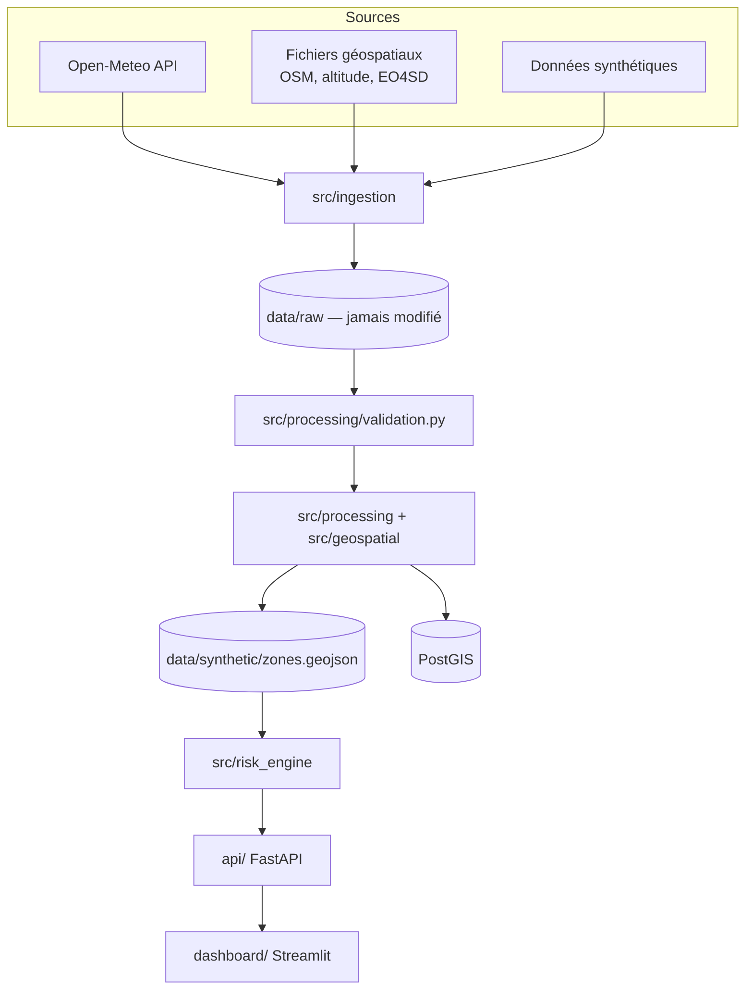

# Architecture

## Flux de données

## Rôle de chaque couche

| Couche | Rôle | Pourquoi séparée ? |
|---|---|---|
| Ingestion | Récupérer sans transformer | Garder l'original pour rejouer le pipeline |
| Validation | Détecter données manquantes, doublons, coordonnées/unités invalides | Une donnée fausse donne un score faux sans erreur visible |
| Traitement / géospatial | Grille de zones, normalisation, attributs | Mettre toutes les sources sur la même unité spatiale |
| Stockage | GeoJSON (MVP) ; PostGIS (chargeur fourni) | Requêtes spatiales en SQL en V3 |
| Risk Engine | Calculer score, niveaux, scénarios, ressources | Testable sans API ni base |
| API | Unique porte d'accès | Remplacer le dashboard sans toucher au calcul |
| Dashboard | Présenter au décideur | Ne calcule rien |

## Modèle de données (PostGIS)

`zones` (géométrie) ← `zone_features` (attributs) ; `scenarios` ← `risk_scores` (hazard, vulnerability, exposure, score, level) ; `weather_forecast` ; `recommendations`. Voir `sql/schema.sql`.

`risk_scores` conserve les **trois blocs à côté du score final** pour pouvoir expliquer chaque résultat.

## Pourquoi ces technologies

| Techno | Justification |
|---|---|
| Python / Pandas / NumPy | Standard de la data, tests faciles |
| Shapely | Géométries (grille, contour) sans dépendance lourde |
| PostgreSQL + PostGIS | Requêtes spatiales (intersections, distances) |
| FastAPI | Validation automatique + Swagger |
| Streamlit + Folium | Dashboard et carte rapides, 100 % Python |
| Docker Compose | Même environnement chez tout le monde |
| *Airflow, Kafka* | **Reportés** (V2, V5) : pas de besoin réel dans le MVP |
